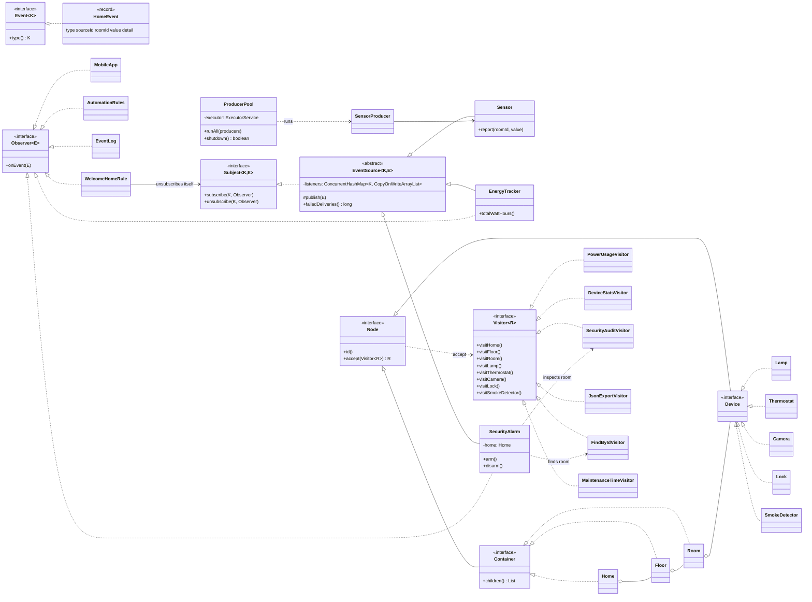

# Smart Home — Observer & Visitor (Assignment 6, Variant 7)

A small Java 17 system for a smart home:

* **Observer.** Sensors (power meter, climate sensor, motion sensor) push immutable events to listeners
  (mobile app, energy tracker, security alarm, automation rules, event log, welcome rule).
* **Visitor.** A stable Composite tree `Home → Floor → Room → devices` is processed by visitors
  (power usage, statistics, security audit, JSON export, find by id, maintenance time).
* **Integration.** A `MOTION` event makes `SecurityAlarm` run `SecurityAuditVisitor` on **that room only** and
  publish a `SECURITY_REPORT` event back into the system (alert → inspection → report).

Only Java 17 and JUnit 5. No other libraries.

## How to run

```bash
mvn test                                   # all tests
mvn package
java -jar target/smart-home-observer-visitor-1.0.jar 4 2000   # [threads] [eventsPerProducer]
```

## Package structure

| Package | Content |
|---|---|
| `observer` | Generic `Event<K>`, `Observer<E>`, `Subject<K,E>`, `EventSource<K,E>` (thread-safe registry) |
| `event` | `EventType`, immutable `HomeEvent` record |
| `source` | `Sensor`, a data source (subject) |
| `listener` | `EnergyTracker` (observer **and** subject), `MobileApp`, `AutomationRules`, `EventLog`, `WelcomeHomeRule` |
| `home` | Composite tree: `Node`, `Container`, `Device`, `Home`, `Floor`, `Room`, `Lamp`, `Thermostat`, `Camera`, `Lock`, `SmokeDetector`, and the `Visitor<R>` interface |
| `visitor` | `PowerUsageVisitor`, `DeviceStatsVisitor`, `SecurityAuditVisitor`, `JsonExportVisitor`, `FindByIdVisitor`, `MaintenanceTimeVisitor` |
| `integration` | `SecurityAlarm`, the Observer → Visitor link |
| `concurrency` | `ProducerPool` (ExecutorService wrapper), `SensorProducer` |
| `app` | `SmartHomeApp` (composition root), `SimulationConfig`, `SampleHome` |

## Design decisions

### Observer

* **Own generic interfaces.** `Subject<K, E extends Event<K>>` and `Observer<E>`. `java.util.Observable` is not used.
* **Events are immutable.** `HomeEvent` is a `record` with a required `EventType`.
* **Subscription per event type.** `subscribe(EventType, Observer)`. A listener only gets the types it asked for.
* **Push model.** The event carries everything (`roomId`, `value`, `detail`). We chose push because:
  1. events are immutable values, so pushing them to many threads is safe;
  2. listeners do not need a reference back to the subject to read its state (less coupling);
  3. with pull, the subject state could already be changed by another producer thread when the listener reads it.
* **Chain of observers.** `EnergyTracker` listens to `POWER_READING` and republishes an aggregated
  `ENERGY_SUMMARY` every N readings. `MobileApp` listens to it. `SecurityAlarm` is a second chain link
  (`MOTION` → `SECURITY_REPORT`).
* **Join and leave at runtime, also inside a handler.** `WelcomeHomeRule` unsubscribes itself inside `onEvent`.
  This is safe because `publish` iterates a `CopyOnWriteArrayList` snapshot.
* **A failing listener does not break the others.** Its exception is caught and counted (`failedDeliveries()`).

### Visitor

* **Composite tree with 3 levels below the root.** `Home → Floor → Room → Device`. Containers: `Home`, `Floor`, `Room`.
  Leaves: `Lamp`, `Thermostat`, `Camera`, `Lock` (+ `SmokeDetector` from the trade-off commit).
* **Elements hold data only.** They are records, and the only method is `accept`.
* **Double dispatch.** `node.accept(visitor)` picks the method by the *real class of the node* (1st dispatch).
  Inside, `visitor.visitLamp(this)` picks the method by the *real class of the visitor* (2nd dispatch).
  A plain `visitor.visit(node)` cannot work: Java chooses overloads at compile time by the declared type `Node`.
* **The visitor does the traversal, not the tree.** Reasons:
  * `JsonExportVisitor` must wrap children inside `"children":[ ... ]`, so it needs control over when the children are visited;
  * `FindByIdVisitor` stops as soon as the node is found (the tree would always visit everything);
  * each visitor combines child results differently (sum, list, string).
  To avoid duplication between `visitHome`, `visitFloor` and `visitRoom`, all containers implement `Container.children()`,
  and each visitor has one private helper (`sumChildren`, `collectChildren`...).
* **Visitors.**
  * `PowerUsageVisitor`: numeric calculation, watts of the subtree;
  * `DeviceStatsVisitor`: accumulates state (counters) across the whole tree, read with `stats()`;
  * `SecurityAuditVisitor`: filter, returns the list of weak points (unlocked locks, cameras not recording);
  * `JsonExportVisitor`: hand-written JSON with correct nesting;
  * `FindByIdVisitor`: finds the subtree for an event (used by the integration);
  * `MaintenanceTimeVisitor`: added in the trade-off commit.

### Integration

`motionSensor → MOTION(room=bedroom) → SecurityAlarm`
→ `home.accept(new FindByIdVisitor("bedroom"))` → `room.accept(new SecurityAuditVisitor())` (bedroom subtree only)
→ `SECURITY_REPORT(value=2, detail="balcony-door, bedroom-camera")` → `MobileApp`, `EventLog`.

### Concurrency (Clean Code ch. 13)

* `ProducerPool` runs producers on an `ExecutorService`. The thread count is configurable (`args[0]`).
* **Registry without locking the whole subject.** `ConcurrentHashMap<EventType, CopyOnWriteArrayList<Observer>>`:
  different event types never block each other, and publishing never takes a lock (reads go to a snapshot).
* **Shared state.** `LongAdder`, `DoubleAdder`, `AtomicLong`, `AtomicBoolean`, `AtomicReference`, `ConcurrentHashMap`,
  `ConcurrentLinkedQueue`. The Composite tree is immutable, so many threads can visit it at the same time.
* **No lost events.** Events are delivered synchronously in the producer thread, so when a producer task is done,
  all its events have reached their listeners.
* **Graceful shutdown.** `shutdown()` → `awaitTermination(timeout)` → `shutdownNow()` only if needed. No hanging threads.
* **Unsubscribe while other threads publish.** A `publish` that has already started finishes on its snapshot
  (the listener may get that one last event), and every later `publish` no longer sees the listener. No exception.
  `WelcomeHomeRule` uses `compareAndSet` so it reacts only once even when two threads deliver at the same moment.

### Clean Code (ch. 11–12)

* **One composition root:** `SmartHomeApp.main`. All objects are created and wired there.
* **Constructor injection only.** Dependencies are `final` fields. No setters, no lazy initialization.
* **No class without a reason.** One `Sensor` class instead of three almost identical sensor classes.
  `Container` removes duplicated traversal code. `Device` makes sure a `Room` contains only devices.

## Trade-off proof

| Commit | What | Files changed |
|---|---|---|
| `8f6cb44` Trade-off 1 | New **visitor** | `MaintenanceTimeVisitor.java`, `MaintenanceTimeVisitorTest.java` |
| `e47125a` Trade-off 2 | New **element type** | `SmokeDetector.java`, `Visitor.java`, `DeviceStatsVisitor.java`, `FindByIdVisitor.java`, `JsonExportVisitor.java`, `MaintenanceTimeVisitor.java`, `PowerUsageVisitor.java`, `SecurityAuditVisitor.java`, `SmokeDetectorTest.java` |

**The cost.**

* **New operation (visitor): cheap.** 1 new class + its test. No element class and no other visitor was touched
  (Open/Closed for operations).
* **New element type: expensive.** 1 new class, plus the `Visitor` interface, plus **every** existing visitor
  (6 classes) had to change. With N visitors, a new element costs N + 2 file changes, and the code does not compile
  until all of them are updated.

**When I would reject Visitor.** When new element types appear often and operations rarely, for example a
device catalogue where vendors add new device types every month. Then plain polymorphism (a method inside
each device class) is cheaper. Visitor is the right choice here because the set of device types is stable
and new reports and operations keep being added.

## Tests

27 JUnit 5 tests (`mvn test`):

| Class | What is checked |
|---|---|
| `EventSourceTest` (7) | per-type delivery, unsubscribe, self-unsubscribe inside handler, subscribe during publish, duplicate subscribe, failing listener isolation, event immutability |
| `ListenersTest` (2) | `EnergyTracker` chain → `MobileApp`, automation rules |
| `VisitorTest` (8) | **hand-calculated** results: power 1603 W / 1573 W / 1565 W, stats, audit list, exact JSON, find by id |
| `SecurityAlarmTest` (3) | integration: event → visitor on subtree → report event |
| `ConcurrencyTest` (3) | **stress: 4 threads × 1000 events = exactly 4000** (+ exactly 4 summaries), unsubscribe while publishing, graceful shutdown |
| `MaintenanceTimeVisitorTest` (2) | new visitor: 95 min and 45 min |
| `SmokeDetectorTest` (2) | new element works in every visitor |

Hand calculation for `SampleHome` (only devices that are on / recording count, locks always draw 5 W):

```
kitchen:     lamp 60 + thermostat 1500 + lock 5 = 1565 W
living-room: lamp off 0 + camera 8               =    8 W
bedroom:     lamp 25 + lock 5 + camera off 0     =   30 W
floor-1 = 1565 + 8 = 1573 W,  home = 1573 + 30 = 1603 W
```

## UML class diagram


Source: [`docs/uml.mmd`](docs/uml.mmd) (Mermaid).


